# 📋 Panduan Demo Sistem Antrean Rumah Sakit (SIMRS Medika Utama)
**Dokumen Pengujian & Evaluasi Praktikum Pemrograman Web (Modul 3 - Tugas 2)**  
*Clinical-Grade Multi-Screen Queue System (Zero External Framework, Native TypeScript, Pure CSS3 Google Stitch Design Tokens)*

---

## 🎯 Ringkasan Skenario Pengujian

Sistem Antrean Rumah Sakit **SIMRS Medika Utama** dirancang untuk bekerja secara **sinkron real-time lintas tab/jendela** (*multi-window synchronized environment*) tanpa backend server eksternal, memanfaatkan `LocalStorage`, Custom Event, Storage Event API, Web Audio API sintetis, dan Web Speech API bahasa Indonesia.

Untuk pengalaman demo paling optimal di hadapan dosen dan asisten laboratorium, disarankan menyiapkan **tata letak layar terbagi (Split Screen)** atau membuka minimal **3 tab browser secara berdampingan**:
1. **Jendela Kiri**: Kiosk Pasien (`ambil-antrian.html`)
2. **Jendela Tengah**: Konsol Operator Loket (`operator.html`)
3. **Jendela Kanan**: Display TV Ruang Tunggu (`layar.html`)
4. **Tab Terpisah**: Dashboard Manajemen Admin (`index.html`)

---

## 🔑 Tabel Kredensial Uji DummyJSON

Autentikasi sistem terhubung langsung ke REST API [DummyJSON Auth](https://dummyjson.com/docs/auth) (`POST https://dummyjson.com/auth/login`). Tersedia juga tombol **Quick-Select Role** pada antarmuka `login.html` untuk mempermudah demonstrasi tanpa perlu mengetik manual.

| Role Sistem | Username | Password | Nama Tenaga Medis | ID Staf / NIP | Loket Default | Otorisasi & Hak Akses |
| :--- | :--- | :--- | :--- | :--- | :--- | :--- |
| **Admin** | `emilys` | `emilyspass` | dr. Hendra Setiawan, Sp.PD | `MED-00101` | Loket 1 - Pendaftaran Umum | Akses penuh: Dashboard Admin (`index.html`) & Konsol Operator (`operator.html`) |
| **Moderator (Supervisor)** | `oliviaw` | `oliviawpass` | Ns. Budiarto Santoso, S.Kep | `MED-44210` | Loket 3 - Poli Anak & Imunisasi | Akses penuh (Paritas Admin): Dashboard Admin & Konsol Operator |
| **Operator (User)** | `averyp` | `averyppass` | Rina Astuti, A.Md.RMIK | `MED-88402` | Loket 2 - Poli Penyakit Dalam | Khusus Konsol Operator (`operator.html`). Ditolak masuk ke Dashboard Admin |

> **URL Referensi Endpoint DummyJSON**:
> - Login Endpoint: `POST https://dummyjson.com/auth/login`
> - Payload: `{"username": "...", "password": "...", "expiresInMins": 60}`
> - Auth Header: `Bearer <token>` (disimpan otomatis di `localStorage.medika_auth_user`)

---

## 🏗️ Diagram Alur Arsitektur & Interaksi Multi-Window

```mermaid
flowchart TD
    subgraph Client["Browser Window Multi-Tab Cluster"]
        direction TB
        Kiosk["🖥️ Kiosk Pasien<br/>(ambil-antrian.html)"]
        Operator["🩺 Konsol Operator<br/>(operator.html)"]
        Display["📺 Display TV Monitor<br/>(layar.html)"]
        Admin["⚙️ Dashboard Admin<br/>(index.html)"]
        Login["🔐 Portal Login<br/>(login.html)"]
    end

    subgraph External["External Services"]
        DummyJSON["☁️ DummyJSON REST API<br/>(POST /auth/login)"]
    end

    subgraph BrowserEngine["Native Browser APIs (Zero-Framework)"]
        StorageEngine[("💾 LocalStorage Engine<br/>• medika_tickets<br/>• medika_services<br/>• medika_active_ticket<br/>• medika_last_call_event")]
        BroadcastEvent["⚡ Window Storage Event & Custom Event Sync"]
        AudioSynthesizer["🔊 Web Audio API<br/>(Ding-Dong Chime 659Hz-784Hz)"]
        SpeechEngine["🗣️ Web Speech API<br/>(id-ID Voice Synthesizer)"]
        PrintEngine["🖨️ CSS3 @media print<br/>(Thermal Slip 80mm EPSON TM-T82)"]
    end

    Login -- "1. Autentikasi Kredensial" --> DummyJSON
    Login -- "2. Simpan Sesi & Token" --> StorageEngine
    
    Kiosk -- "3. Ambil Nomor Antrean (Triage)" --> StorageEngine
    Admin -- "4. Cetak Tiket Manual / CRUD Poli" --> StorageEngine
    
    StorageEngine -. "5. Trigger Sinkronisasi Instan" .-> BroadcastEvent
    BroadcastEvent -. "Notifikasi Perubahan State" .-> Display
    BroadcastEvent -. "Notifikasi Perubahan State" .-> Operator
    BroadcastEvent -. "Notifikasi Perubahan State" .-> Admin

    Operator -- "6. Panggil Antrean Berikutnya" --> StorageEngine
    Operator -- "Trigger Suara" --> AudioSynthesizer
    Operator -- "Trigger Pengumuman" --> SpeechEngine

    Display -- "7. Deteksi Event Panggilan" --> AudioSynthesizer
    Display -- "8. Siarkan Nomor Antrean" --> SpeechEngine

    Kiosk -- "9. Cetak Struk Kertas" --> PrintEngine
    Admin -- "10. Cetak Manual F9" --> PrintEngine
```

---

## 👣 Langkah Pengujian Terpandu (5 Halaman Sistem)

### LANGKAH 1: Pengujian Halaman Login (`login.html`)
**Tujuan**: Memverifikasi sistem autentikasi, proteksi hak akses, dan kepatuhan UI klinik.

1. Buka `http://localhost:5500/login.html` (atau port Live Server aktif Anda).
2. Periksa status banner di atas formulir: `SERVER KLINIK ONLINE • SIMRS V4.8.2 TERHUBUNG`.
3. **Uji Visibilitas Kata Sandi**:
   - Ketik kata sandi apa saja, klik ikon mata (`visibility`), pastikan teks sandi berganti antara mode sensor (`password`) dan teks terbuka (`text`).
4. **Uji Quick-Select Role**:
   - Klik kartu **Admin** (`dr. Hendra S.`). Formulir otomatis terisi: `emilys` / `emilyspass` dengan loket *Loket 1*.
   - Klik tombol **Masuk ke Sistem (Enter ↵)**.
   - **Hasil yang Diharapkan**: Muncul indikator spinner loading, sesi tersimpan, dan diarahkan secara mulus ke `index.html` (Dashboard Admin).
5. **Uji Proteksi Hak Akses (Route Guard)**:
   - Buka kembali `login.html`, klik kartu **Operator** (`Rina Astuti` - `averyp`).
   - Masuk ke sistem -> otomatis masuk ke `operator.html`.
   - Coba ketik manual URL `http://localhost:5500/index.html` di address bar browser.
   - **Hasil yang Diharapkan**: Route guard langsung mencegat akses, menolak operator membuka halaman admin, dan mengembalikan tampilan ke `operator.html`.

---

### LANGKAH 2: Pengujian Dashboard Manajemen Admin (`index.html`)
**Tujuan**: Memverifikasi operasional poliklinik, metrik KPI, mesin tiket manual, dan audit trail.

1. Masuk sebagai **Admin** (`emilys`) atau **Moderator** (`oliviaw`).
2. Periksa kartu metrik di bagian atas:
   - `Total Tiket Hari Ini`, `Sedang Dipanggil`, `Menunggu di Ruang Tunggu`, `Poliklinik Aktif Melayani`.
3. **Uji Manajemen Layanan / Poliklinik (CRUD Poliklinik)**:
   - Klik tombol **Tambah Layanan Baru** (`+`).
   - Masukkan Kode Layanan: `E` (1 huruf kapital).
   - Masukkan Nama Layanan: `Poli Gigi & Mulut`.
   - Simpan -> Unit baru langsung tampil pada tabel dan dropdown loket.
   - Klik tombol status `Aktif` pada salah satu poli untuk mengubahnya menjadi `Non-aktif`.
   - Klik ikon `restart_alt` untuk mereset urutan nomor poli tertentu kembali ke `001`.
4. **Uji Penerbitan Tiket Manual (Loket Admisi)**:
   - Pada panel kanan (*Mesin Cetak Tiket Manual*), pilih poli tujuan: misal `Poli Umum (A)`.
   - Pilih kategori prioritas: Klik radio button **Disabilitas** atau **VIP**.
   - Masukkan Nomor RM/NIK: `RM-2026-9912`.
   - Perhatikan kotak **Pratinjau Tiket Siap Cetak** yang memperbarui nomor, waktu, dan watermark secara langsung.
   - Klik tombol **Cetak Tiket Manual** (atau tekan tombol keyboard `F9`).
   - **Hasil yang Diharapkan**: Notifikasi toast hijau muncul, nomor bertambah, dan metrik dashboard terupdate instan.
5. **Uji Ekspor Laporan Harian (CSV & JSON)**:
   - Klik tombol dropdown **Ekspor Laporan Harian**.
   - Klik **Ekspor File CSV (.csv)** -> Browser otomatis mengunduh file `laporan_antrian_harian_YYYY-MM-DD.csv` berstandar RFC 4180 lengkap dengan kolom Nomor Tiket, Layanan, Prioritas, Status, Loket, dan Timestamp.
   - Klik **Audit Trail JSON (.json)** -> Browser mengunduh snapshot backup operasional SIMRS lengkap.

---

### LANGKAH 3: Pengujian Kiosk Pendaftaran Mandiri Pasien (`ambil-antrian.html`)
**Tujuan**: Memverifikasi antarmuka *self-service touch kiosk* untuk pasien rawat jalan.

1. Buka `ambil-antrian.html` pada jendela terpisah atau mode split-screen.
2. Perhatikan komponen antarmuka ramah pengguna:
   - Jam digital presisi detik `HH:mm:ss WIB`.
   - Pengalih bahasa instan: Klik tombol **ID** (Bahasa Indonesia) atau **EN** (English).
3. **Uji Pemilihan Jalur Prioritas (Clinical Triage)**:
   - Klik salah satu tombol prioritas di bagian atas:
     - `Umum & Reguler` (Jalur Pasien Umum)
     - `Lansia / Geriatri` (> 60 tahun)
     - `Disabilitas & Khusus` (Akses Kursi Roda)
     - `VIP / Fast-Track` (Rujukan Eksekutif)
   - Indikator ring highlight biru berpindah dengan feedback toast yang jelas.
4. **Uji Pengambilan Tiket**:
   - Sentuh/klik salah satu kartu layanan: misal **Poli Umum (A)** atau **Poli Penyakit Dalam (B)**.
   - Muncul modal pratinjau tiket klinis berukuran struk thermal yang mencantumkan:
     - Nomor antrean yang akan didapat (misal `A-002`).
     - Estimasi waktu tunggu dan jumlah pasien yang sedang mengantre di depan.
     - Timestamp tanggal dan waktu cetak.
   - Klik tombol hijau **Cetak Tiket Sekarang**.
   - Modal tertutup dan notifikasi toast hijau memberitahukan tiket berhasil dicetak.
5. **Uji Fitur Aksesibilitas**:
   - Klik tombol **Panduan Suara** (`volume_up`): Sistem memutar panduan audio sintetis.
   - Klik tombol **Panggil Perawat** (`notifications_active`): Mengirimkan simulasi panggilan darurat admisi.

---

### LANGKAH 4: Pengujian Konsol Operator Loket (`operator.html`)
**Tujuan**: Memverifikasi pemanggilan antrean, audio broadcast, pengurutan prioritas, dan navigasi keyboard.

1. Buka `operator.html` dengan login sebagai operator (misal `averyp` di Loket 2).
2. **Uji Suara Mandiri**:
   - Klik tombol **Tes Suara Panggilan**:
   - Anda akan mendengar **nada lonceng klinis 2-nada (ding-dong)** yang lembut, disusul suara sintesis Bahasa Indonesia: *"Nomor antrian A, nol nol satu, silakan menuju Loket 02."*
3. **Uji Mesin Triage Prioritas (Priority Sorting Verification)**:
   - Lihat tabel antrean tunggu di panel kanan.
   - Jika ada tiket **VIP** atau **Disabilitas**, tiket tersebut secara otomatis berada di baris teratas mendahului tiket Reguler yang datang lebih awal.
   - Gunakan filter tab: Klik `Semua`, `Prioritas`, atau `Normal` untuk menyaring tampilan.
4. **Uji Pemanggilan Antrean**:
   - Klik tombol besar **Panggil Berikutnya** (atau tekan `F3` / `Spasi`).
   - Tiket berpindah ke kartu aktif pemanggilan (*Active Calling Deck*):
     - Nomor tiket terpampang besar dengan font tabular.
     - Timer durasi pelayanan mulai menghitung otomatis (`00:01`, `00:02`...).
     - Penghitung frekuensi panggilan mencatat `1 Kali`.
     - Audio pengumuman bersuara secara jernih.
5. **Uji Kontrol Pelayanan Loket**:
   - Tekan tombol **Panggil Ulang** (atau `F2`): Frekuensi panggilan bertambah (`2 Kali`) dan audio bersuara kembali.
   - Tekan tombol **Selesai Layani** (atau `F5`): Status tiket berubah menjadi `done`, timer berhenti, kartu aktif kembali standby.
   - Panggil tiket berikutnya lalu tekan **Lewati / Tidak Hadir** (atau `F4`): Status tiket berubah menjadi `skipped`.
6. **Uji Pemanggilan Spesifik Langsung dari Tabel**:
   - Klik tombol **Panggil** pada salah satu baris antrean tertentu di tabel untuk memanggil pasien spesifik di luar urutan otomatis.

---

### LANGKAH 5: Pengujian Display TV Ruang Tunggu (`layar.html`)
**Tujuan**: Memverifikasi monitor visual publik, siaran suara otomatis lintas-jendela, dan mode layar penuh.

1. Buka `layar.html` pada jendela terpisah (letakkan berdampingan dengan `operator.html`).
2. Periksa elemen visual TV monitor:
   - Header: Tanggal lengkap format Bahasa Indonesia (misal: `SENIN, 12 OKTOBER 2026`) dan jam digital real-time.
   - Panel Kiri (*Hero Call Display*): Area raksasa untuk tiket yang sedang aktif dipanggil lengkap dengan badge triage bercahaya dan teks panduan loket.
   - Panel Kanan (*Station Cards Grid*): Kartu status seluruh loket poliklinik yang memperlihatkan nomor terkini dan sisa antrean yang sedang menunggu.
3. **Uji Sinkronisasi Otomatis Tanpa Refresh (Multi-Tab Live Sync)**:
   - Di tab `operator.html`, klik **Panggil Berikutnya**.
   - **Perhatikan tab `layar.html` seketika**:
     - Nomor tiket di Hero Display langsung berubah dalam hitungan milidetik.
     - Kartu loket terkait di panel kanan diberi highlight bingkai tebal dengan status berkedip `Dipanggil`.
     - Tanpa menyentuh tab `layar.html`, **suara lonceng dan pengumuman audio ikut tersiar otomatis** dari display TV!
4. **Uji Mode Fullscreen TV**:
   - Klik tombol **Layar Penuh TV** (`fullscreen`) di pojok kanan atas (atau tekan tombol `F`).
   - Layar display akan memenuhi seluruh monitor tanpa address bar browser, siap untuk TV ruang tunggu rumah sakit. Tekan `Escape` untuk keluar.

---

## 🌟 Rincian Fitur Nilai Tambah & Keunggulan Khusus

### 1. Dual Audio Engine: Ding-Dong Web Audio API + Web Speech API (id-ID)
* **Bebas Dependensi MP3/Audio Eksternal**: Nada lonceng rumah sakit (*hospital chime*) dibangkitkan secara sintetis langsung dari memori browser menggunakan **Web Audio API** frekuensi sinus murni (*Sine Wave Oscillators*):
  - Nada 1: E5 (659.25 Hz, gain 0.2, decay 350ms)
  - Nada 2: G5 (783.99 Hz, gain 0.25, decay 550ms)
* **Artikulasi Tenang & Natural**: Pengucapan nomor tiket dikonfigurasi khusus dengan artikulasi `lang = 'id-ID'` dan `rate = 0.92`.
* **Pengejaan Digit Terpisah**: Nomor antrean seperti `A-003` diurai menjadi `A, nol nol tiga` agar jelas terdengar oleh pasien lansia dan tidak terbaca rancu sebagai angka "tiga".
* **Audio Unlock Shield**: Menangani kebijakan *Autoplay Policy* browser modern (Chromium/Safari) dengan membuka kunci `AudioContext` secara otomatis pada interaksi pertama klik/sentuh layar.

### 2. Standar Cetak Kertas Thermal Printer 80mm (`@media print`)
* Mengadopsi standar cetak thermal printer rumah sakit (seperti EPSON TM-T82, Janz, atau Xprinter):
  - Lebar cetak dipatok presisi pada `width: 80mm` dengan padding `10mm`.
  - Mengisolasi hanya modal struk yang tampak (`visibility: visible`), sementara seluruh background dashboard, tombol aksi, dan navbar disembunyikan total (`visibility: hidden; display: none !important`).
  - Dilengkapi watermark rumah sakit, tanggal/jam pencetakan, dan teks panduan loket.

### 3. Ekspor Data Laporan CSV (RFC 4180 Standar) & JSON Audit Trail
* Tersedia di Dashboard Admin (`index.html`):
  - **CSV Generator**: Menggunakan escaping karakter standar RFC 4180 dan menambahkan **UTF-8 Byte Order Mark (BOM: `\uFEFF`)** sehingga file `.csv` dapat langsung dibuka di Microsoft Excel versi apa pun tanpa masalah karakter rusak/mojibake.
  - **Audit Trail JSON**: Mengemas seluruh snapshot antrean harian, konfigurasi poliklinik, statistik operasional, dan identitas admin penanggung jawab untuk kebutuhan integrasi SIMRS/HIS Cloud.

### 4. Sinkronisasi Real-Time Dwifungsi (Local Storage Event & Fallback Polling)
* Memanfaatkan `window.addEventListener('storage', ...)` yang memicu pembaruan instan (<10ms) antar tab/window saat operator memanggil tiket atau pasien mengambil antrean.
* Dilengkapi mekanisme cadangan *heartbeat short-polling* (interval 1.5 – 2.5 detik) untuk menjamin data tetap sinkron bahkan jika browser menahan event storage di tab latar belakang (*background tab throttle*).

### 5. Aksesibilitas Keyboard Pintar (Clinical Operator Hotkeys)
Petugas loket dapat mengoperasikan konsol pemanggilan sepenuhnya tanpa mouse:
* **F2**: Panggil Ulang Tiket Aktif (*Repeat Call*)
* **F3** atau **Spasi**: Panggil Tiket Berikutnya (*Next Ticket*)
* **F4**: Lewati Pasien Tidak Hadir (*Skip Ticket*)
* **F5**: Selesaikan Pelayanan Konsultasi (*Complete Ticket*)
* **F9**: Cetak Tiket Cepat pada Dashboard Admin (*Quick Print*)
* **Escape**: Menutup Modal Pratinjau / Tambah Layanan

---

## 🛠️ Checklist Evaluasi Praktikum

| No | Komponen Penilaian | Status Implementasi | Lokasi Pengujian |
| :---: | :--- | :---: | :--- |
| 1 | **Struktur Arsitektur TypeScript Murni** | ✅ 100% Native TS (ES2020) | `src/models`, `src/services`, `src/pages` |
| 2 | **Zero External Framework Runtime** | ✅ Zero Dependency | Bebas dari Bootstrap, Tailwind CDN, jQuery |
| 3 | **Autentikasi DummyJSON API** | ✅ REST API Integration | `login.html`, `src/services/auth.ts` |
| 4 | **Hak Akses Admin vs Operator** | ✅ Route Guard & Paritas | Admin/Moderator full, Operator isolated |
| 5 | **Mesin Antrean Triage Prioritas** | ✅ VIP > Disabilitas > Lansia > Normal | `src/services/queue.ts` |
| 6 | **5 Halaman Antarmuka Lengkap** | ✅ Login, Admin, Loket, TV, Kiosk | Semua file `.html` terhubung rapi |
| 7 | **Siaran Suara Web Speech API & Chime** | ✅ Bahasa Indonesia + Dual-Tone Chime | `src/services/speech.ts` |
| 8 | **Sinkronisasi Multi-Tab Lintas Jendela** | ✅ Storage Event + Fallback Heartbeat | `src/services/storage.ts` |
| 9 | **Ekspor CSV & Cetak Thermal Printer** | ✅ RFC 4180 BOM & CSS3 @media print | `src/services/export.ts`, `css/style.css` |
| 10 | **Pengujian Otomatis E2E** | ✅ 27 / 27 Unit Test Lolos | `node test_e2e_verification.js` |

*Selamat Melaksanakan Evaluasi & Demonstrasi Praktikum!*
