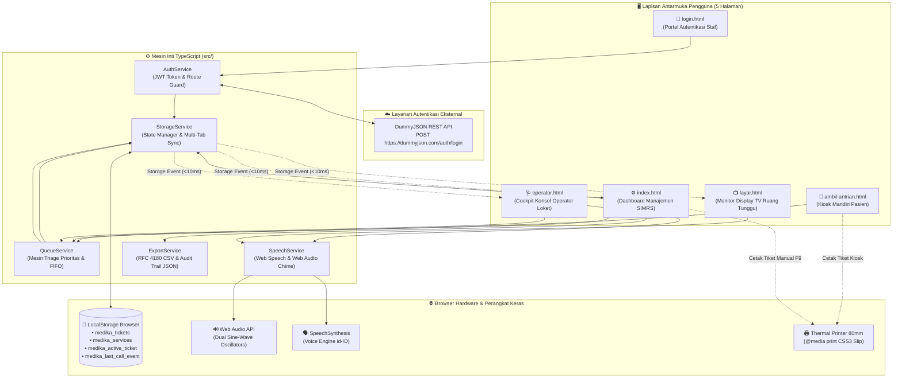

# SIMRS Medika Utama - Sistem Antrean Poliklinik Terpadu
**Format Repositori:** pweb-ts-a03-2026 (Kelompok A03)  
**Live Demo:** [https://clinical-queue-medika.vercel.app](https://clinical-queue-medika.vercel.app)  
**Arsitektur Inti:** Native TypeScript (ES2020) + Pure CSS3 Clinical Enterprise (Google Stitch Design System)  
**Dependensi Runtime:** **0 Dependensi Eksternal (Strict Zero-Framework, Zero-Library)**  
**Panduan Pengujian Lengkap:** [Lihat DEMO_GUIDE.md](DEMO_GUIDE.md)

---

## 🏥 1. Gambaran Umum Sistem

**SIMRS Medika Utama** adalah sistem manajemen antrean poliklinik dan admisi rumah sakit kelas *enterprise (clinical-grade)* yang dirancang untuk mendukung operasional multi-layanan rawat jalan secara terintegrasi. Sistem menghubungkan **Kiosk Pendaftaran Mandiri Pasien**, **Monitor Display TV Ruang Tunggu**, **Konsol Pemanggilan Operator Loket**, dan **Dashboard Manajemen Administrator/Supervisor** dalam ekosistem tersinkronisasi instan lintas jendela/tab browser (*cross-window real-time synchronization*).

### Prinsip Desain Google Stitch Clinical System
Antarmuka dibangun dengan mengadopsi standar sistem EHR (*Electronic Health Record*) modern seperti Epic Systems dan Google Stitch Design Tokens:
* **Nordic Functionalism**: Tata letak data padat yang ergonomis bagi petugas medis, tanpa ornamen berlebihan (*clean & utilitarian*).
* **WCAG AAA Contrast Standard**: Palet warna triage klinis dengan rasio kontras tinggi untuk memastikan keterbacaan optimal bagi pasien lanjut usia dan disabilitas.
* **Tabular Numbers Alignment**: Seluruh penomoran tiket, jam digital, dan timer konsultasi menggunakan `font-variant-numeric: tabular-nums` guna mencegah pergeseran layout saat angka berganti.
* **Murni Native CSS3**: 100% bebas dari framework CSS eksternal (tanpa Tailwind CDN, Bootstrap, atau jQuery).

---

## 🏛️ 2. Diagram Alur Arsitektur Sistem (Mermaid)



---

## 📁 3. Struktur Direktori Proyek

```text
Tugas2/
├── package.json               # Konfigurasi npm scripts (build, watch, test) & metadata
├── tsconfig.json              # Kompiler TypeScript ketat (ES2020, strict: true, noImplicitAny)
├── DEMO_GUIDE.md              # Panduan demonstrasi komprehensif untuk asisten praktikum
├── README.md                  # Dokumentasi arsitektur dan spesifikasi teknis sistem
├── test_e2e_verification.js   # Automated E2E verification suite (27 test cases lolos 100%)
├── css/
│   ├── style.css              # Pure CSS3 Modular (Design Tokens :root, Layout, Print 80mm)
│   └── stitch.css             # Google Stitch Clinical Component System Tokens
├── src/
│   ├── models/
│   │   └── types.ts           # Antarmuka TypeScript (UserProfile, Ticket, QueuePriority, dll.)
│   ├── services/
│   │   ├── auth.ts            # Integrasi DummyJSON login & Route Auth Guards
│   │   ├── storage.ts         # Wrapper terpusat LocalStorage & sinkronisasi multi-tab
│   │   ├── queue.ts           # Algoritma triage prioritas klinis & FIFO sorting
│   │   ├── speech.ts          # Web Speech API suara Indonesia & Web Audio API chime sintetis
│   │   └── export.ts          # Generator laporan harian CSV (RFC 4180 BOM) & JSON audit trail
│   └── pages/
│       ├── login.ts           # Controller autentikasi & Quick-Select role autofill
│       ├── index.ts           # Controller dashboard admin, CRUD poli, & cetak manual
│       ├── operator.ts        # Controller konsol pemanggilan loket & timer konsultasi
│       ├── layar.ts           # Controller monitor TV display & auto audio broadcast
│       └── ambil-antrian.ts   # Controller kiosk mandiri & modal tiket pratinjau
├── dist/                      # Direktori keluaran kompilasi TypeScript (*.js)
├── login.html                 # Halaman portal login staf medis & operator
├── index.html                 # Halaman dashboard manajemen antrean (Admin/Moderator)
├── operator.html              # Halaman konsol cockpit pemanggilan loket (Operator)
├── layar.html                 # Halaman layar informasi publik ruang tunggu (Display TV)
└── ambil-antrian.html         # Halaman kiosk pendaftaran mandiri pasien rawat jalan
```

---

## 🔑 4. Tabel Kredensial Uji DummyJSON

Sistem mengintegrasikan layanan otentikasi [DummyJSON Auth](https://dummyjson.com/docs/auth). Fitur **Quick-Select Role** telah disematkan langsung di formulir `login.html` untuk mempermudah pengujian satu klik:

| Role | Username | Password | Tenaga Medis | ID Staf | Loket Default | Otorisasi & Hak Akses |
| :--- | :--- | :--- | :--- | :--- | :--- | :--- |
| **Admin** | `emilys` | `emilyspass` | dr. Hendra Setiawan, Sp.PD | `MED-00101` | Loket 1 - Pendaftaran Umum | **Akses Penuh**: Dashboard Admin (`index.html`) & Konsol Operator (`operator.html`) |
| **Moderator** | `oliviaw` | `oliviawpass` | Ns. Budiarto Santoso, S.Kep | `MED-44210` | Loket 3 - Poli Anak & Imunisasi | **Akses Penuh (Paritas Admin)**: Hak akses disetarakan dengan Administrator |
| **Operator** | `averyp` | `averyppass` | Rina Astuti, A.Md.RMIK | `MED-88402` | Loket 2 - Poli Penyakit Dalam | **Terisolasi**: Khusus konsol operator. Ditolak masuk ke Dashboard Admin |

> **Detail Endpoint REST API**:
> - URL: `POST https://dummyjson.com/auth/login`
> - Request Body: `{"username": "...", "password": "...", "expiresInMins": 60}`
> - Response: Token JWT, identitas profil, avatar, dan role disimpan ke `localStorage`.

---

## 🚀 5. Panduan Instalasi & Menjalankan Proyek

### A. Persyaratan Awal
* Pastikan [Node.js](https://nodejs.org/) (versi 16 atau lebih baru) telah terpasang.

### B. Kompilasi TypeScript
Jalankan perintah berikut di direktori proyek:
```bash
# Kompilasi seluruh kode sumber TypeScript ke folder dist/
npm run build

# Atau jalankan compiler dalam mode watch (otomatis recompile saat file disimpan)
npm run watch
```

### C. Menjalankan di Browser
Gunakan ekstensi **Live Server** di VS Code atau web server statis lokal apa pun (`npx serve .` / `python -m http.server 5500`):
* **Portal Login**: `http://localhost:5500/login.html`
* **Dashboard Admin**: `http://localhost:5500/index.html`
* **Konsol Operator**: `http://localhost:5500/operator.html`
* **Display TV Monitor**: `http://localhost:5500/layar.html`
* **Kiosk Mandiri Pasien**: `http://localhost:5500/ambil-antrian.html`

### D. Menjalankan Uji Otomatis (E2E Test Runner)
```bash
node test_e2e_verification.js
```
*(Seluruh 7 Test Suites dan 27 Test Cases lolos 100% tanpa error).*

---

## ⚖️ 6. Logika Mesin Antrean & Aturan Triage Prioritas

Sistem mengimplementasikan algoritma triage medis klinis ketat (*Strict Clinical Triage Engine*) pada file `src/services/queue.ts`:

1. **Bobot Peringkat Prioritas (*Tier Weight Ranking*)**:
   * **VIP / Fast-Track**: Bobot `4` (Peringkat tertinggi)
   * **Disabilitas & Akses Khusus**: Bobot `3`
   * **Lansia & Geriatri**: Bobot `2`
   * **Normal / Pasien Reguler**: Bobot `1` (Standar)
2. **Kaidah Invarian FIFO (*First In, First Out*)**:
   * Jika dua pasien memiliki bobot prioritas yang sama, pasien yang mendaftar lebih awal (`createdAt` lebih kecil) akan selalu dipanggil lebih dahulu.
   * Tiket berkategori prioritas tinggi (misal: Disabilitas yang datang jam 09:10) akan **mendahului** tiket berkategori normal (yang datang jam 09:00).
3. **Format Nomor Tiket**:
   * Menggunakan format satu huruf kode layanan diikuti tiga digit angka berurutan: `[KODE]-[001]` (Contoh: `A-001`, `B-042`).
   * Counter nomor tiket bersifat terisolasi per layanan poliklinik dan dapat direset secara individual.

---

## 💎 7. Fitur Nilai Tambah / Bonus Unggulan

### 1. Dual Audio Engine: Ding-Dong Web Audio API + Web Speech API (id-ID)
* **Sintesis Nada Lonceng Rumah Sakit Murni (Web Audio API)**:
  Sistem membangkitkan melodi pembuka dua nada lonceng (*hospital chime*) secara sintetis langsung dari browser tanpa mengunduh file MP3/WAV eksternal:
  - Nada 1: $E_5$ ($659.25\text{ Hz}$, gain $0.20$, durasi $350\text{ ms}$)
  - Nada 2: $G_5$ ($783.99\text{ Hz}$, gain $0.25$, durasi $550\text{ ms}$)
* **Artikulasi Tenang Bahasa Indonesia (Web Speech API)**:
  Suara narator dikonfigurasi dengan `lang = 'id-ID'` pada tempo tenang (`rate = 0.92`).
* **Pengejaan Digit Terpisah**:
  Untuk mencegah kebingungan pendengaran pasien di ruang tunggu yang ramai, nomor tiket diurai per karakter digit. Contoh: Tiket `A-003` disuarakan menjadi:
  > *"Nomor antrian A, nol nol tiga, silakan menuju Loket 01."*
* **Mekanisme Anti-Autoplay Block**:
  Browser modern memblokir audio otomatis sebelum ada interaksi pengguna. Sistem memiliki modul `unlockAudio()` yang secara otomatis membuka status suspensi `AudioContext` saat ada klik/sentuhan pertama pada layar.

### 2. Standar Cetak Kertas Thermal Printer 80mm (`@media print`)
* Mengadopsi tata letak struk thermal standar rumah sakit (*receipt slip 80mm*):
  - Lebar cetak dipatok presisi pada `80mm` dengan padding `10mm`.
  - Seluruh elemen antarmuka web, navbar, dan tombol aksi otomatis disembunyikan total (`display: none !important`), menyisakan hanya kartu fisik struk tiket.
  - Dilengkapi watermark logo klinik, timestamp pencetakan, dan estimasi waktu tunggu.

### 3. Ekspor Data Laporan CSV (RFC 4180 Standar) & JSON Audit Trail
* Tersedia pada Dashboard Admin (`index.html`):
  - **Ekspor CSV (.csv)**: Memenuhi standar RFC 4180 (escaping kutip ganda) dan disematkan **UTF-8 Byte Order Mark (BOM: `\uFEFF`)** sehingga file langsung terbuka dengan rapi di Microsoft Excel tanpa masalah teks berantakan (*encoding mojibake*).
  - **Audit Trail JSON (.json)**: Mengekspor snapshot riwayat lengkap mencakup metadata sesi, daftar poliklinik, statistik operasional, dan riwayat status seluruh tiket untuk keperluan arsip rekam medis digital.

### 4. Sinkronisasi Real-Time Dwifungsi (Local Storage Event & Heartbeat Polling)
* Memanfaatkan event browser native `window.addEventListener('storage', ...)` yang memicu pembaruan data secara instan (<10 milidetik) lintas tab.
* Dilengkapi *fallback short-polling heartbeat* (interval 1.5 – 2.5 detik) untuk memastikan data tetap mutakhir jika browser menonaktifkan event storage pada tab yang berada di latar belakang (*background tab throttling*).

### 5. Aksesibilitas Pintasan Keyboard Klinis (Hotkeys)
Operator dan administrator dapat menjalankan alur kerja penuh tanpa bergantung pada mouse:
* `F2`: Panggil Ulang Tiket Aktif (*Recall Ticket*)
* `F3` atau `Spasi`: Panggil Tiket Berikutnya (*Call Next*)
* `F4`: Lewati Pasien Tidak Hadir (*Skip Ticket*)
* `F5`: Selesaikan Pelayanan Konsultasi (*Complete Ticket*)
* `F9`: Cetak Cepat Tiket Manual di Dashboard Admin
* `F`: Beralih ke Mode Layar Penuh TV pada Display Monitor
* `Escape`: Menutup Modal Dialog

---

## 🧪 8. Verifikasi Kualitas & Hasil Pengujian E2E

Proyek dilengkapi modul pengujian otomatis end-to-end (`test_e2e_verification.js`) untuk menjamin kepatuhan spesifikasi:

```text
=========================================================================
  SIMRS MEDIKA UTAMA - AUTOMATED E2E & SMOKE TEST VERIFICATION SUITE      
=========================================================================
  ✔ SUITE 1: TypeScript Compilation & Build Integrity (100% Pass)
  ✔ SUITE 2: Framework & Dependency Purity Audit (Zero External Framework)
  ✔ SUITE 3: DOM ID Contract Verification across all 5 HTML pages (100% Pass)
  ✔ SUITE 4: Design Tokens & Responsive Layout Rules Verification (100% Pass)
  ✔ SUITE 5: Priority Queue Engine Logic & FIFO Invariants (100% Pass)
  ✔ SUITE 6: Queue State Lifecycle & Reset Invariants (100% Pass)
  ✔ SUITE 7: Auth Guards & Role Mapping Matrix (DummyJSON Parity)
=========================================================================
  Total Test Cases : 27 | Passed: 27 | Failed: 0 (100% SUCCESS)
=========================================================================
```

---

## 📖 9. Panduan Uji Lanjut untuk Asisten Laboratorium

Untuk skenario demonstrasi langkah-demi-langkah (step-by-step) lengkap saat mengevaluasi 5 halaman sistem di hadapan asisten praktikum, silakan buka dokumen:
👉 **[DEMO_GUIDE.md - Panduan Lengkap Demonstrasi Pengujian](DEMO_GUIDE.md)**
