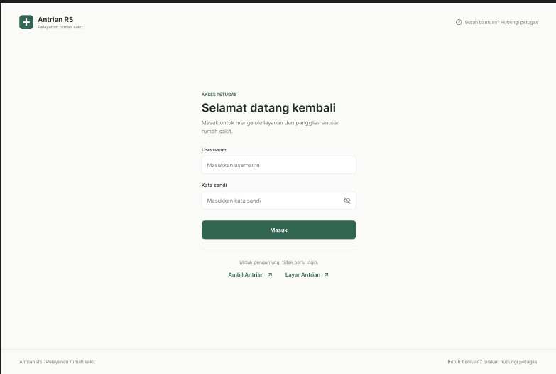
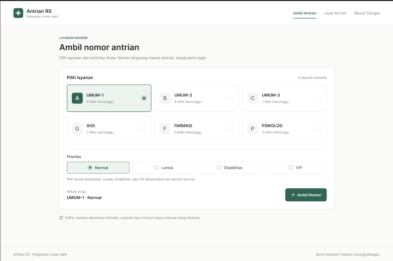
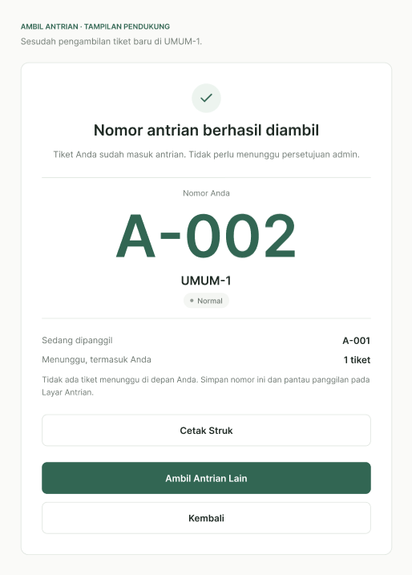
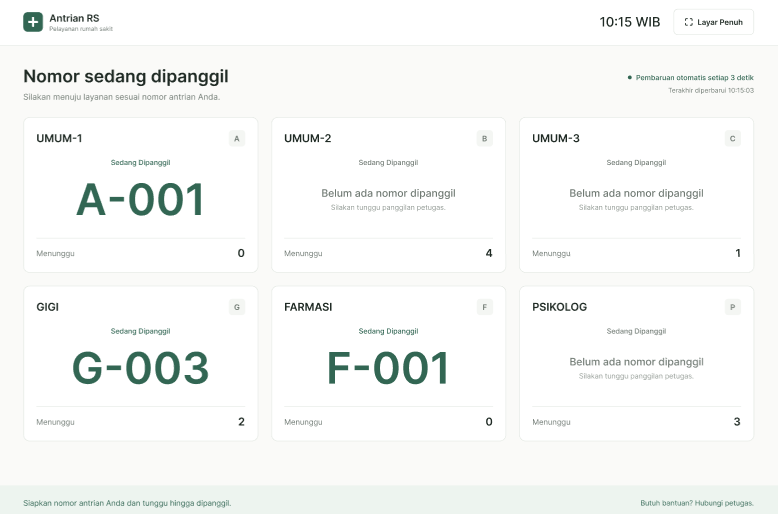
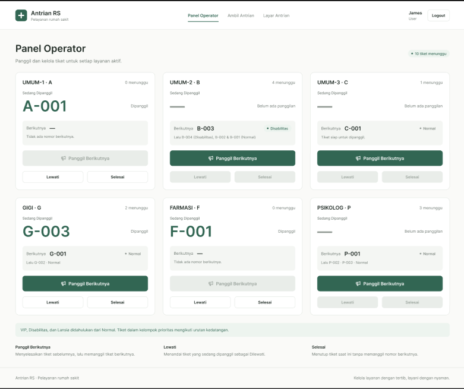
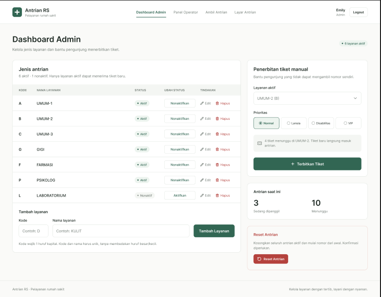

# Sistem Antrian Rumah Sakit

Aplikasi antrian rumah sakit berbasis web yang dibangun dari awal (*native*) menggunakan **HTML5, Native CSS, dan TypeScript**, tanpa menggunakan framework atau pustaka eksternal.

- **Demo Live (Vercel)**: [https://antrian-rumah-sakit.vercel.app](https://antrian-rumah-sakit.vercel.app)
- **Repositori GitHub**: [https://github.com/Afahmisan/pweb-ts-a03-2026](https://github.com/Afahmisan/pweb-ts-a03-2026)

---

## Tangkapan Layar Aplikasi

### 1. Halaman Login Petugas (`login.html`)
Formulir autentikasi petugas terintegrasi dengan endpoint POST DummyJSON. Mengarahkan pengguna secara otomatis ke halaman yang sesuai dengan hak akses (Admin ke Dashboard, Petugas Loket ke Panel Operator).



---

### 2. Kiosk Mandiri Pengunjung (`ambil-antrian.html`)
Halaman publik bagi pengunjung rumah sakit untuk memilih poliklinik dan kategori pasien tanpa memerlukan login.



---

### 3. Modal Struk Nomor Antrian
Tampilan nomor antrian terdaftar dengan rincian poliklinik, kategori prioritas, jumlah pasien menunggu di depan, dan tombol cetak struk fisik (`window.print()`).



---

### 4. Layar Monitor Antrian Ruang Tunggu (`layar.html`)
Layar monitor publik untuk ruang tunggu. Menampilkan nomor yang sedang dipanggil per loket, kartu status layanan aktif, indikator berkedip untuk aksesibilitas pasien, tombol mode layar penuh (Fullscreen API), dan panggilan suara otomatis.



---

### 5. Panel Operator Loket (`operator.html`)
Panel kendali pemanggilan bagi petugas loket. Mengurutkan antrian berdasarkan tingkatan prioritas (VIP, Disabilitas, Lansia, Normal) dan waktu kedatangan (FIFO). Dilengkapi tombol **Panggil Berikutnya**, **Panggil Ulang**, **Lewati**, dan **Selesai**.



---

### 6. Dashboard Admin (`index.html`)
Halaman pengelolaan data antrian khusus administrator. Mencakup penambahan jenis layanan baru (kode 1 huruf kapital `^[A-Z]$`), penolakan kode dan nama duplikat secara *case-insensitive*, pengaktifan/penonaktifan layanan, hapus layanan, reset nomor antrian ke 001, serta penerbitan tiket manual bagi pengunjung tanpa ponsel.



---

## 5 Halaman Utama

| Halaman | Berkas | Akses | Fungsi Utama |
| :--- | :--- | :---: | :--- |
| **Login** | [`login.html`](login.html) | Publik | Formulir masuk dengan indikator loading, verifikasi DummyJSON, dan pengalihan rute berbasis peran. |
| **Kiosk Pasien** | [`ambil-antrian.html`](ambil-antrian.html) | Publik | Pilihan poliklinik dan tingkat prioritas dengan tiket format 3-digit (`A-001`). |
| **Layar Monitor** | [`layar.html`](layar.html) | Publik | Tampilan antrian aktif dengan pembaruan berkala (2-3 detik) dan tombol Fullscreen API. |
| **Panel Operator** | [`operator.html`](operator.html) | Petugas | Pemanggilan tiket berdasarkan urutan prioritas, penandaan selesai, dan penanganan pasien lewati. |
| **Dashboard Admin** | [`index.html`](index.html) | Admin / Mod | CRUD layanan, validasi kode/nama unik, penerbitan tiket manual, dan reset nomor antrian ke 001. |

---

## Akun Pengujian

Data akun rujukan dari DummyJSON:

| Username | Password | Role API | Hak Akses | Halaman Tujuan |
| :--- | :--- | :--- | :--- | :--- |
| **`emilys`** | `emilyspass` | `admin` | Administrator | `index.html` (Dashboard Admin) |
| **`oliviaw`** | `oliviawpass` | `moderator` | Setara Admin | `index.html` (Dashboard Admin) |
| **`averyp`** | `averyppass` | `user` | Petugas Loket | `operator.html` (Panel Operator) |
| **`michaelw`** | `michaelwpass` | `user` | Petugas Loket | `operator.html` (Panel Operator) |

*Catatan: Halaman `layar.html` dan `ambil-antrian.html` dapat dibuka langsung tanpa masuk log.*

---

## Arsitektur Teknis

- **Penyimpanan Lokal (LocalStorage)**:
  - `hospital_session`: Sesi login, token, dan peran pengguna aktif.
  - `hospital_services`: Master data jenis poliklinik/layanan.
  - `hospital_tickets`: Daftar seluruh tiket antrian aktif dan riwayat status.
  - `hospital_counters`: Penghitung urutan nomor tiket 3-digit per layanan.
- **Sinkronisasi Antar-Tab**: Komunikasi real-time lintas tab peramban menggunakan `BroadcastChannel` dan `StorageEvent`, dilengkapi fallback interval polling 2-3 detik.
- **Logika Antrian Prioritas**:
  - Bobot prioritas: `VIP` (4) > `Disabilitas` (3) > `Lansia` (2) > `Normal` (1).
  - Tiket dengan prioritas sama diurutkan secara FIFO berdasarkan waktu pengambilan (`createdAt`).
- **Fitur Audio Panggilan**:
  - Pengumuman suara Bahasa Indonesia alami via Web Speech API (*id-ID*).
  - Bel sintetis dua nada (*ding-dong*) via Web Audio API.

---

## Menjalankan di Komputer Lokal

### 1. Prasyarat
- Node.js versi 18 atau lebih baru.

### 2. Pemasangan dan Kompilasi
```bash
git clone https://github.com/Afahmisan/pweb-ts-a03-2026.git
cd pweb-ts-a03-2026

# Pasang dependensi compiler (TypeScript)
npm install

# Kompilasi berkas TypeScript ke dist/
npm run build
```

### 3. Menjalankan Server Lokal
```bash
npm start
```
Buka peramban pada alamat [http://localhost:3000](http://localhost:3000).

---

## Struktur Direktori

```
.
├── css/
│   └── style.css            # Desain antarmuka CSS native
├── dist/                    # Berkas JavaScript hasil kompilasi TypeScript
├── figma/                   # Berkas aset dan tangkapan layar antarmuka
├── src/                     # Berkas kode sumber TypeScript
├── .gitignore
├── .vercelignore
├── ambil-antrian.html       # Kiosk Mandiri Pengunjung
├── index.html               # Dashboard Admin
├── layar.html               # Layar Monitor Antrian
├── login.html               # Formulir Masuk Petugas
├── operator.html            # Panel Operator Loket
├── package.json             # Konfigurasi skrip npm dan dependensi dev
├── README.md                # Dokumentasi proyek
├── server.mjs               # Server statis lokal bawaan
├── tsconfig.json            # Konfigurasi kompilasi TypeScript
└── vercel.json              # Konfigurasi deployment Vercel
```
